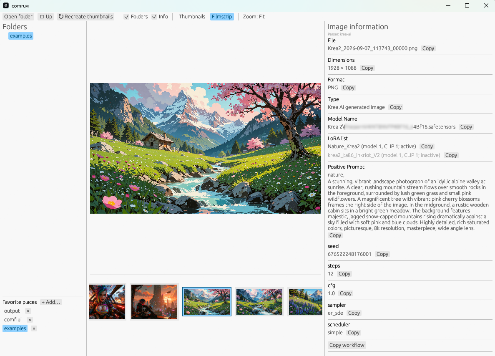

# comruvi

**comruvi** (ComfyUI Rust Viewer) is a local-first image browser intended for
AI-generated images. It shows folders, thumbnail and filmstrip views, and the
generation metadata embedded in an image. It currently supports PNG and JPEG.
The UI and filesystem code use portable Rust APIs.

comruvi is a fully AI coded Project using both ChatGPT 5.6 and CursorAI.



## How to Install

A packaged installer is currently available **only for Windows**. On **macOS** and
**Linux**, build and start from source with Cargo (see below). The project has been
successfully compiled and run on Windows and on Fedora Linux 44.

### Windows

Download the MSI from the
[GitHub Releases](https://github.com/astolzen/comruvi/releases) page, or build it
from a clone (Rust + [WiX 5](https://wixtoolset.org/) `dotnet tool install -g wix`):

```powershell
powershell -ExecutionPolicy Bypass -File .\installer\build-msi.ps1
# optional zip + script installer:
powershell -ExecutionPolicy Bypass -File .\installer\pack-windows.ps1
```

**MSI:** `dist/comruvi-<version>-windows-x64.msi`

```powershell
msiexec /i dist\comruvi-0.0.8-windows-x64.msi
# quiet, keep existing config/parsers:
msiexec /i dist\comruvi-0.0.8-windows-x64.msi CONFLICTACTION=Keep /qn
```

The installer shows an early-alpha Accept/Decline warning, then the **AGPL-3.0**
license. If config/parsers already exist, a Yes/No dialog appears:
**Yes = Overwrite** (dated backup), **No = Keep** (installer copies named with the
build version).

Both the MSI and the zip installer (`dist/comruvi-<version>-windows-x64.zip` →
**install.bat**):

- copy `comruvi.exe` to `%LOCALAPPDATA%\comruvi\`
- install default config/parsers under `%USERPROFILE%\.config\comruvi\`
  (`lastfolder` = Pictures, `thumbnailsize = "160x160"`)
- conflict handling as above; quiet MSI: `CONFLICTACTION=Overwrite|Keep`;
  script: `-ConflictAction …`
- add a Start Menu shortcut

Uninstall: `msiexec /x …` or `uninstall.ps1` (add `-RemoveConfig` to delete
config/parsers).

### macOS and Linux (and Windows from source)

The package version lives in the repo-root [`VERSION`](VERSION) file (About dialog,
config.toml, and the Windows installer scripts all read it). Bump that file when
cutting a release; `build.rs` keeps `Cargo.toml` in sync.

Install the current stable Rust toolchain from [rustup](https://rustup.rs/), then
clone or download this project and run:

```bash
cargo run --release -- <folder-with-images>
```

On Windows PowerShell the same command works. Alternatively, use **Open folder**
in the app after launch. Original images are never written. Next to the images
comruvi may create:

- `.thumbnails/` — PNG thumbnails (Geeqie-compatible names: `image.jpg` →
  `.thumbnails/image.jpg.png`)
- `.metadata/` — JSON sidecars for generation metadata (`image.png` →
  `.metadata/image.png.json`), built in the background like thumbnails and
  rebuilt via **Recreate → Metadata**

Supported input formats in this alpha release are PNG, JPG, and JPEG.

## Using the viewer

- On Windows you can set comruvi as the default app for PNG/JPEG. Double-click or
  **Open with** opens the file's folder in **Thumbnails** and the image in the
  separate viewer. If comruvi is already running, that instance switches folder
  and viewer instead of starting a second window. The same path works from the
  command line: `comruvi.exe C:\path\to\image.png`.
- **Filter** in the toolbar: enter a **volltext** phrase (e.g. `blue eyes`) to show
  only images whose `.metadata` sidecar contains that phrase
  (case-insensitive, whole phrase including spaces). **reset** clears the filter.
  The Filter button stays highlighted while a filter is active.
- The **Folders** pane is a tree with its own scrollbar. Click a name to open that
  folder; use the chevron controls to expand or collapse. **Up** (with arrow icon)
  moves to the parent. The lower **Favorite places** area provides persistent
  shortcuts.
- Choose **Thumbnails** for a grid or **Filmstrip** for the selected image plus a
  centered thumbnail strip. Click an image to select it; double-click to open the
  separate viewer window. **Left/Right** move the selection in both modes;
  **Up/Down** move by grid row in Thumbnails; **Home** / **End** jump to the
  first or last image. Arrow / Home / End scroll the selection into view; mouse
  wheel scrolling does not snap back to the selection.
- The open folder is watched for new or removed images so the view updates while
  comruvi is running.
- **Shift+drag** a thumbnail (or the filmstrip / viewer image) into an open
  ComfyUI browser window to open a tab with the embedded workflow — same as
  dropping from Explorer or Digikam.
- In the filmstrip image and separate viewer, scroll the mouse wheel or press
  **Up/Down** to zoom, and drag with the mouse to pan. Press **0** to reset to fit
  window or **1** for 100% (actual-pixel) zoom. Filmstrip mode shows the current
  zoom level in the top toolbar.
- The metadata pane is driven by **translator** files: each image is matched to a
  parser config by a trigger, then the right pane shows the configured fields.
  Copy buttons place values on the system clipboard.
- **Recreate thumbnails** performs work in the background. A progress indicator is
  displayed while thumbnails are created or updated. JPEG EXIF orientation is
  applied for filmstrip, the separate viewer, and newly built thumbnails.

## Settings and favorite places

comruvi creates a readable TOML configuration at
`~/.config/comruvi/config.toml` (on Windows, `%USERPROFILE%\.config\comruvi\config.toml`).
It records `version = 0.08`, the last opened folder, `parserdir` (directory of
translator files), and up to ten favorites as `quick0` through `quick9`; unused
quick keys are omitted. It also writes the reserved future settings
`thumbnailsize`, `fonttype`, `fontsize`, and `displaymode`. The lower part of
the Folders pane provides controls to add, select, and remove favorites.

When an AI image embeds a ComfyUI `workflow` chunk, the info pane offers
**Copy workflow**.

## Metadata translators

Display of the right-hand info pane is modular. Human-readable TOML **parser /
translator** files live in `parserdir` (default
`~/.config/comruvi/parsers`). On first run, comruvi copies the shipped defaults
from the repo's `parsers/` folder into that directory (existing files are never
overwritten).

Shipped defaults cover Krea2, Anima-style positive/negative workflows, Z-Image,
Flux2 lora stacks, a generic ComfyUI fallback, and digital-camera JPEGs (EXIF).
Add or edit TOML files in `parserdir` to teach comruvi new formats without
recompiling.

**Full syntax reference:** [parsers/README.md](parsers/README.md) — identity
keys, triggers, field sources (`constant` / `input` / `extract` / `exif`),
built-ins, and examples.

For PNG files comruvi reads `tEXt` and uncompressed `iTXt` chunks without modifying
the image. JPEG EXIF is read for camera metadata and for **Orientation** when
displaying or thumbnailing photos. Compressed PNG `zTXt` is not yet parsed.

## License

comruvi is licensed under the [GNU Affero General Public License v3.0](LICENSE)
(AGPL-3.0).

## Credits

No code has been copied from other viewers. The thumbnail layout and filename
convention are intentionally compatible with [Geeqie](https://github.com/BestImageViewer/geeqie).
Comruvi is an independed project and not affiliated with ComfyUI. It does neither collect nor upload any telemetry or other user data. 

## Current status

**Alpha 8 (0.08).** Implemented: folder tree with independent scroll, persistent
favorites, thumbnail grid, filmstrip, live folder watching, Shift+drag to ComfyUI,
Home/End navigation, background thumbnail and `.metadata` cache generation,
modular metadata translators (ComfyUI + EXIF photo), JPEG orientation-aware
display, a synchronized secondary viewer window with zoom/pan, Windows MSI
installer, embedded taskbar icon, file-association / single-instance open, and
toolbar **Filter** (volltext phrase search). See
[CHANGELOG.md](CHANGELOG.md) for the detailed history.
